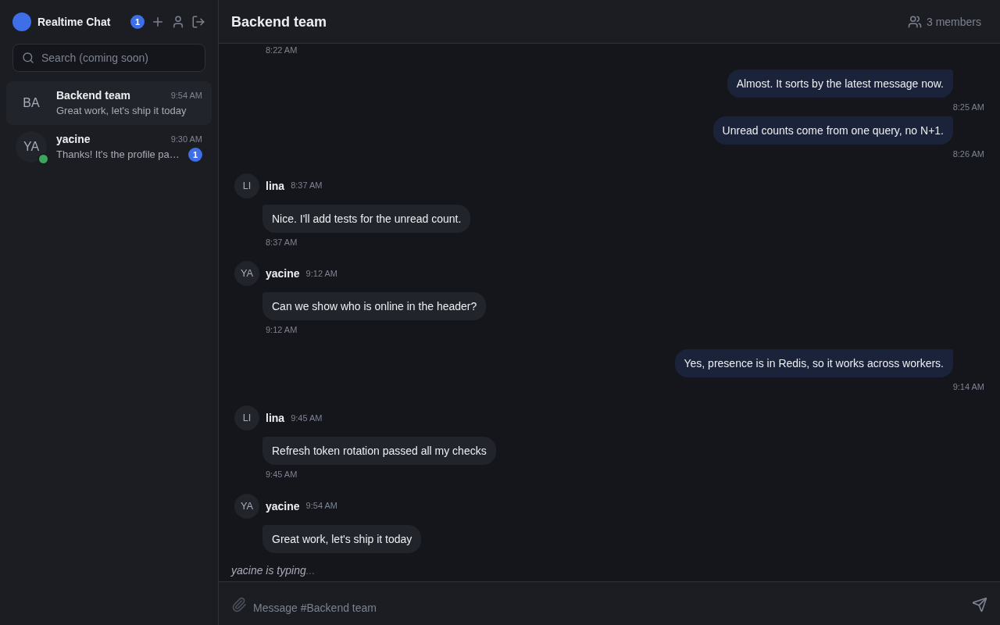
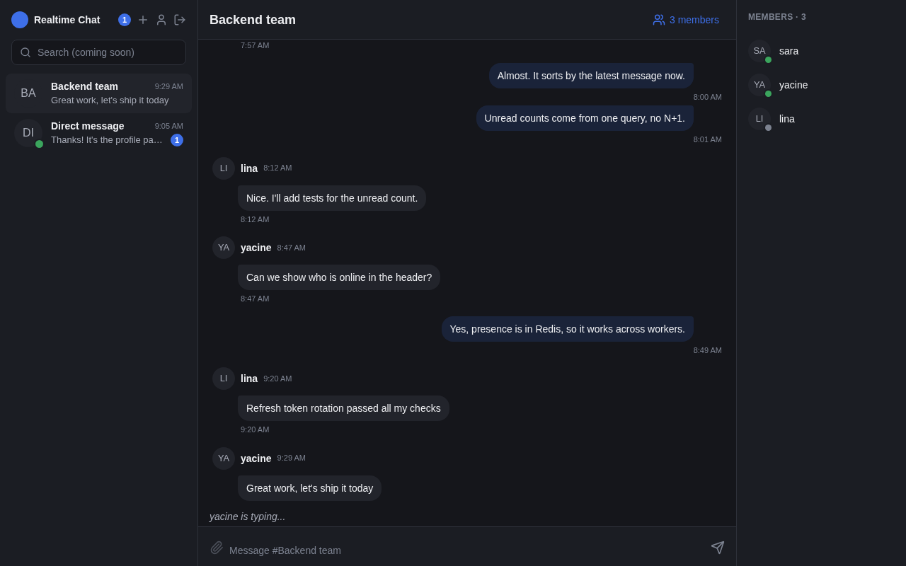
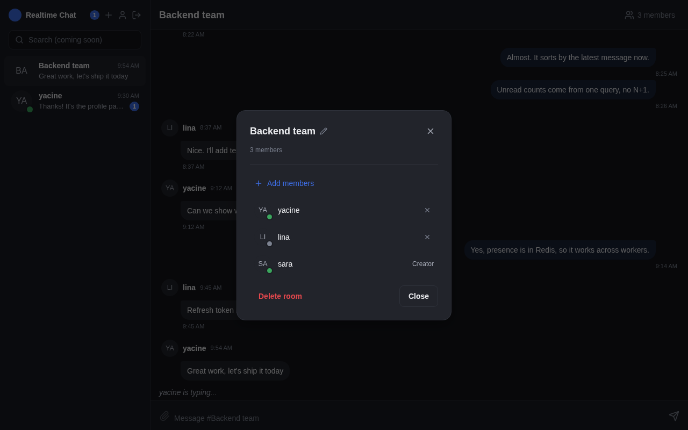
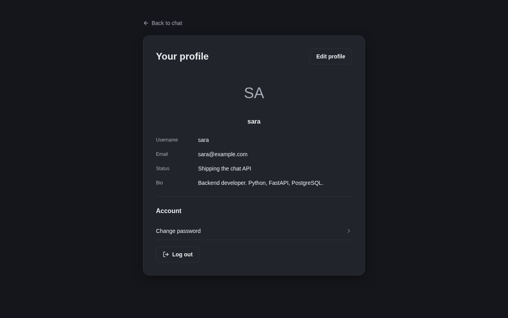
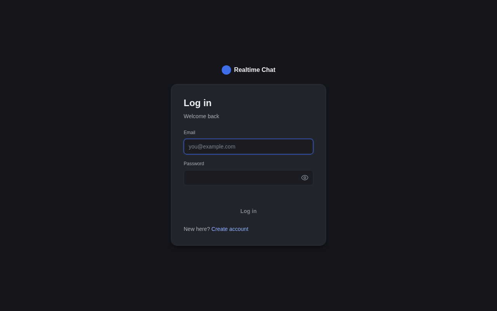
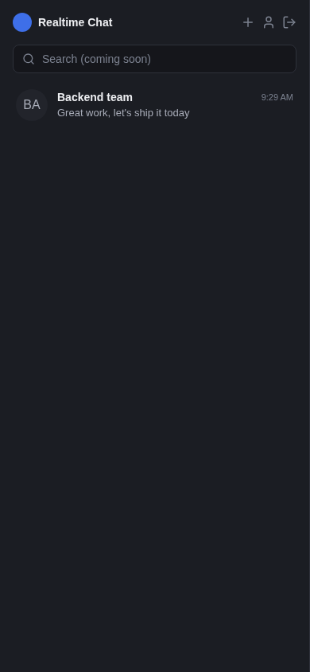
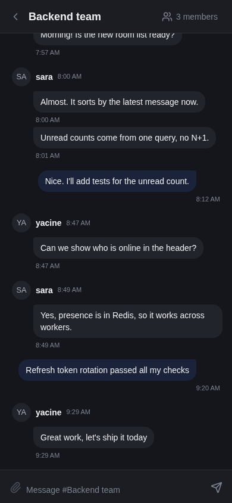

# Realtime Chat

[](https://github.com/amineaiba/realtime_chat_fastapi/actions/workflows/ci.yml)

A real-time chat app with a FastAPI backend and a small React frontend.
It has direct messages and group rooms, live messages, typing indicators, online status, and user profiles.

The focus of this project is the backend: secure JWT auth with refresh token rotation, a clean layered design, Socket.IO on the same server as the REST API, and Redis for presence.

**Stack:** Python · FastAPI · PostgreSQL · SQLAlchemy · Alembic · Socket.IO · Redis · Cloudinary · React · TypeScript · Tailwind · Docker · pytest · GitHub Actions



---

## Features

- **Auth:** register, login, logout, change password. Short-lived access token + single-use refresh token in an httpOnly cookie.
- **Rooms:** direct messages (one room per pair of users) and group rooms with a creator who manages members.
- **Messages:** saved in PostgreSQL, sent live over Socket.IO, cursor-based history, edit and soft delete.
- **Unread counts:** per room and in total, in one query (no N+1).
- **Presence and typing:** online status in Redis, typing indicators per room.
- **Profiles:** bio, status, location, avatar upload to Cloudinary (JPEG/PNG/GIF/WebP, max 5 MB, checked by file content, not by the header).
- **Rate limiting** on auth endpoints (per IP).

## Screenshots

| Group members and presence | Manage a group |
|---|---|
|  |  |

| Profile | Login |
|---|---|
|  |  |

| Mobile: rooms | Mobile: chat |
|---|---|
|  |  |

---

## Run it locally

You need Docker. One command starts the backend, the frontend, PostgreSQL, and Redis.

```bash
cp .env.docker.example .env.docker   # set SECRET_KEY to any random string
docker compose up --build
```

- App: http://localhost:5173
- API docs (Swagger): http://localhost:8000/docs

The database tables are created by Alembic when the backend starts.

**Demo data (optional).** Add three users, a group, and a DM:

```bash
docker compose exec backend python -m scripts.seed_demo
```

Log in as `sara@example.com`, `yacine@example.com`, or `lina@example.com`. The password is `Password1` for all of them. Open two browser windows with two users to see live messages, typing, and online status.

Avatar upload needs real Cloudinary keys in `.env.docker`. Everything else works without them.

### Without Docker

You need Python 3.12, Node 20+, PostgreSQL, and Redis running on your machine.

```bash
# Backend
cp .env.example .env            # then edit DATABASE_URL, REDIS_URL, SECRET_KEY
uv venv --python 3.12 && source .venv/bin/activate
uv pip install -r requirements.txt
alembic upgrade head
uvicorn main:app --reload

# Frontend (second terminal)
cd frontend
cp .env.example .env            # VITE_API_URL=http://localhost:8000
npm install
npm run dev
```

`ALLOWED_ORIGINS` is a JSON list, for example `["http://localhost:5173"]`.

---

## Tests and CI

The tests run against a real PostgreSQL and Redis (no mocks for the database), and they build the schema with the real Alembic migrations.

```bash
docker compose -f docker-compose.test.yml up -d   # test DB on port 55432, Redis on 56379
uv pip install -r requirements-dev.txt
pytest
```

What they cover:
- register, login, refresh token rotation (an old refresh token is refused), logout (the access token is blocked), change password (all sessions end)
- Socket.IO connect: refresh tokens and logged-out tokens are refused
- DM rooms are not duplicated; only the group creator can rename, delete, add, or remove members
- unread counts (your own messages are never unread)

GitHub Actions runs `ruff check`, `ruff format --check`, and `pytest` for the backend, and `lint` + `build` for the frontend, on every push to `main` and on every pull request.

---

## Architecture

REST and Socket.IO run in one ASGI app and use the same JWT auth.

```
┌──────────────────────────────────────────────┐
│                 FastAPI App                  │
│                                              │
│   REST Routers          Socket.IO (ASGI)     │
│   /auth                 /socket.io           │
│   /profile                                   │
│   /users                                     │
│   /chat                                      │
│        │                      │              │
│   Service Layer         Socket Handlers      │
│   AuthService           connect/disconnect   │
│   ProfileService        join/leave room      │
│   ChatService           send_message         │
│   UserService           typing indicators    │
│        │                      │              │
│   SQLAlchemy · Redis · core/security (JWT)   │
└──────────────────────────────────────────────┘
```

| Folder | Purpose |
|---|---|
| `routers/` | HTTP routes. Thin: they call a service. |
| `services/` | Business logic. |
| `sockets/` | Socket.IO event handlers. |
| `db_models/` | SQLAlchemy models. |
| `schemas/` | Pydantic request and response models, with validation. |
| `core/` | Config, database, JWT, Redis, cookies, logging, Socket.IO server. |
| `alembic/` | Database migrations. |
| `tests/` | pytest suite. |
| `scripts/` | Demo seed script. |
| `frontend/` | React app (see `frontend/README.md`). |

### Data model

```
User ──────┬── Profile        (1:1, cascade delete)
           ├── RefreshToken[] (1:N)
           ├── RoomMember[]   (N:N bridge to Room)
           └── Message[]      (1:N as sender)

Room ──────┬── RoomMember[]   (joined_at, last_read_at per member)
           └── Message[]
```

- A room is a **DM** or a **GROUP**. Groups can be soft-deleted (`is_active`).
- Messages have edit and soft-delete flags.
- All primary keys are UUIDs.

---

## Auth design

- The **access token** (30 min) carries `sub` (user id), `rt_id` (the id of its refresh token in the DB), and a unique `jti`. The frontend keeps it in memory only.
- The **refresh token** (7 days) is stored in the DB and sent as an `httpOnly`, `Secure`, `SameSite=Strict` cookie, limited to the `/auth` path. JavaScript can't read it.
- **Rotation:** each refresh deletes the old refresh token and creates a new pair. A refresh token works only once.
- **Logout** deletes the refresh token of this session only (other devices stay logged in), and puts the access token's `jti` on a **Redis blocklist** until it expires. So a stolen access token stops working right away.
- **Change password** deletes all refresh tokens of the user (logs out every device).
- Protected routes check the token type, so a refresh token can't be used as an access token. The same checks apply to Socket.IO connections.
- Passwords are hashed with bcrypt. Username format and password strength (uppercase + number) are checked by Pydantic.

---

## Real-time (Socket.IO)

Connect to `/socket.io` with the access token in the `auth` payload: `io(API_URL, { auth: { token } })`. Full event docs: [WEBSOCKET_API.md](WEBSOCKET_API.md).

| Client → server | Payload |
|---|---|
| `join_room` | `{ room_id }` (checks membership, marks the room as read) |
| `leave_room` | `{ room_id }` |
| `send_message` | `{ room_id, content }` (saved to DB, then sent to the room) |
| `typing_start` / `typing_stop` | `{ room_id }` |
| `get_online_users` | `{ room_id }` |

| Server → client | Payload |
|---|---|
| `new_message` | `{ id, room_id, user_id, content, created_at }` |
| `user_typing` | `{ room_id, user_id, username, is_typing }` |
| `user_online` / `user_offline` | `{ user_id, message }` |
| `room_joined` | `{ room_id, message, online_users }` |
| `room_left` | `{ room_id, message }` |
| `online_users` | `{ room_id, users }` |
| `error` | `{ message }` |

---

## REST API

Send `Authorization: Bearer <access_token>` on protected routes. Interactive docs: http://localhost:8000/docs

**Auth**

| Method | Endpoint | Description |
|---|---|---|
| `POST` | `/auth/register` | Create an account |
| `POST` | `/auth/login` | Log in (form data: `username` = email, `password`). Returns the access token, sets the refresh cookie. |
| `POST` | `/auth/refresh` | New token pair from the refresh cookie |
| `POST` | `/auth/logout` | End this session |
| `GET` | `/auth/me` | Current user |
| `POST` | `/auth/change-password` | Change password and end all sessions |

**Profile**

| Method | Endpoint | Description |
|---|---|---|
| `GET` | `/profile/me` | Your profile |
| `PATCH` | `/profile/me/` | Update bio, status, phone, location, date of birth |
| `POST` | `/profile/me/avatar` | Upload an avatar |
| `DELETE` | `/profile/me/avatar` | Remove the avatar |

**Users**

| Method | Endpoint | Description |
|---|---|---|
| `GET` | `/users?q=` | Search users by username (min 2 chars, you are excluded) |

**Rooms**

| Method | Endpoint | Description |
|---|---|---|
| `POST` | `/chat/rooms/create` | Create a DM (returns the existing one if it exists) or a group |
| `GET` | `/chat/rooms` | Your rooms, newest activity first, with unread count and last message |
| `GET` | `/chat/rooms/{room_id}` | Room detail with members |
| `PATCH` | `/chat/rooms/{room_id}` | Rename a group (creator only) |
| `DELETE` | `/chat/rooms/{room_id}` | Delete a group (creator only) |
| `POST` | `/chat/rooms/{room_id}/members/add` | Add a member (creator only) |
| `DELETE` | `/chat/rooms/{room_id}/members/{user_id}/delete` | Remove a member (creator only) |
| `DELETE` | `/chat/rooms/{room_id}/leave` | Leave a group (not for the creator) |
| `PUT` | `/chat/rooms/{room_id}/mark-as-read` | Mark a room as read |
| `GET` | `/chat/unread-count` | Total unread messages |

**Messages**

| Method | Endpoint | Description |
|---|---|---|
| `GET` | `/chat/rooms/{room_id}/messages?before_id=&limit=` | History, cursor-based (max 100 per page) |
| `PATCH` | `/chat/messages/{message_id}` | Edit your message |
| `DELETE` | `/chat/messages/{message_id}/delete` | Soft-delete your message |

---

## Known gaps

Things I chose not to build yet:

- **DM names in the room list.** The room list API has no member data, so DM rows say "Direct message" until you open them.
- **File and image messages.** The message model supports them, but there is no upload endpoint yet. The paperclip button is disabled.
- **Sidebar search** is disabled (no message search endpoint).
- **Email verification and password reset.**
- **Rate limits on Socket.IO events.** Only the REST auth endpoints are rate-limited.
- **Presence per user, not per tab.** Closing one of two tabs marks the user offline.
- **Sync database access.** SQLAlchemy runs in sync mode. REST routes run in FastAPI's thread pool, but socket handlers call the DB inside async code. Moving to async SQLAlchemy is the next step for scale.
- **Group admin roles.** Only the creator can manage a group.
